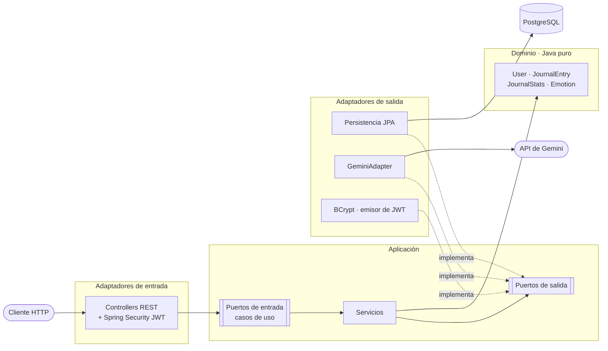

# MindSync API v2

[](https://github.com/carcer21/mindsync-api/actions/workflows/ci.yml)

Backend de **MindSync**, un diario emocional: cada día registras tu energía, tu emoción y unas notas, y la aplicación te devuelve estadísticas y un análisis generado con IA (Google Gemini).

Este repositorio es la **segunda versión** del backend de mi Trabajo de Fin de Grado (DAM). La primera funcionaba, pero al auditarla contra el [OWASP API Security Top 10](https://owasp.org/API-Security/editions/2023/en/0x11-t10/) encontré fallos graves. La v2 la he reescrito desde cero con dos objetivos: **arquitectura hexagonal** y **seguridad bien hecha y demostrada con tests**.

> Los datos de un diario emocional son datos de salud. Todo lo que hay en los tests y ejemplos es inventado.

## Tecnologías

| Área | Herramientas |
|---|---|
| Lenguaje y framework | Java 21, Spring Boot 4.1 |
| Seguridad | Spring Security, JWT (OAuth2 Resource Server, HS256), BCrypt |
| Datos | PostgreSQL 18, Spring Data JPA, Flyway |
| IA | Google Gemini mediante `RestClient` |
| Tests | JUnit 5, Mockito, AssertJ, Testcontainers, MockMvc |
| Calidad | GitHub Actions, JaCoCo, OpenAPI / Swagger UI |

## Arquitectura hexagonal

El dominio y los casos de uso no conocen Spring, ni la base de datos, ni Gemini. Solo conocen **puertos** (interfaces). La infraestructura aporta los **adaptadores** que los implementan.



```
src/main/java/com/carlos/mindsync
├── domain/            modelo y reglas de negocio (sin dependencias)
├── application/
│   ├── port/in/       casos de uso (lo que la app sabe hacer)
│   ├── port/out/      lo que la app necesita de fuera (BD, IA, hash, token)
│   └── service/       implementación de los casos de uso
└── infrastructure/
    ├── adapter/in/web/            controllers, DTOs, manejo de errores
    ├── adapter/out/persistence/   entidades JPA, mappers, repositorios
    ├── adapter/out/ai/            cliente de Gemini y prompt
    ├── security/                  configuración de seguridad, JWT, BCrypt
    └── config/                    cableado de beans y OpenAPI
```

Ventaja práctica: los tests de la lógica no necesitan ni base de datos ni red, y **ningún test llama a Gemini**.

## Cómo arrancarlo

Requisitos: **JDK 21** y **Docker**.

```bash
# 1. Variables de entorno: copia la plantilla y rellénala
cp .env.example .env
```

| Variable | Para qué sirve |
|---|---|
| `DB_URL` | URL JDBC de PostgreSQL (la plantilla ya apunta al contenedor local) |
| `DB_USER`, `DB_PASSWORD` | Credenciales de la base de datos (elígelas tú) |
| `JWT_SECRET` | Secreto para firmar los tokens: mínimo 32 bytes aleatorios. `openssl rand -base64 32` |
| `GEMINI_API_KEY` | Clave de Google AI Studio. **Opcional**: sin ella, el consejo de IA devuelve un texto de reserva |

```bash
# 2. Base de datos
docker compose up -d

# 3. Aplicación (Flyway crea las tablas al arrancar)
./mvnw spring-boot:run        # en Windows: .\mvnw.cmd spring-boot:run
```

- API: `http://localhost:8080`
- Documentación interactiva: `http://localhost:8080/swagger-ui.html` (haz login, pulsa **Authorize** y pega el `accessToken`)

`.env` está en `.gitignore`: ningún secreto se sube al repositorio.

## Endpoints

| Método | Ruta | Token | Descripción |
|---|---|---|---|
| `POST` | `/api/auth/register` | No | Crear cuenta |
| `POST` | `/api/auth/login` | No | Iniciar sesión; devuelve un JWT (caduca a los 30 min) |
| `GET` | `/api/users/me` | Sí | Mi perfil |
| `POST` | `/api/entries` | Sí | Crear una entrada del diario |
| `GET` | `/api/entries?page=0&size=20` | Sí | Mis entradas, de la más reciente a la más antigua |
| `GET` | `/api/entries/{id}` | Sí | Una de mis entradas |
| `DELETE` | `/api/entries/{id}` | Sí | Borrar una de mis entradas |
| `GET` | `/api/stats/me` | Sí | Racha, energía media, emoción predominante y total del mes (últimos 90 días) |
| `GET` | `/api/ai/advice` | Sí | Análisis de IA de mis últimas 14 entradas |

No existe ninguna ruta con el id de usuario: el dueño sale **siempre** del token.

Ejemplo:

```bash
curl -X POST localhost:8080/api/auth/register -H 'Content-Type: application/json' \
  -d '{"name":"Ana","email":"ana@example.com","password":"una-clave-larga"}'

TOKEN=$(curl -s -X POST localhost:8080/api/auth/login -H 'Content-Type: application/json' \
  -d '{"email":"ana@example.com","password":"una-clave-larga"}' | sed 's/.*"accessToken":"\([^"]*\)".*/\1/')

curl -X POST localhost:8080/api/entries -H "Authorization: Bearer $TOKEN" -H 'Content-Type: application/json' \
  -d '{"date":"2026-11-10","energy":7,"emotion":"CALM","notes":"Día tranquilo","tags":["descanso"]}'
```

Emociones admitidas: `JOY`, `CALM`, `GRATITUDE`, `NEUTRAL`, `SADNESS`, `ANXIETY`, `ANGER`, `STRESS`, `FATIGUE`.

Los errores usan siempre el formato estándar `application/problem+json` (RFC 9457); los de validación indican qué campo falla.

## Tests

```bash
./mvnw verify
```

- **281 tests**: unitarios (dominio y servicios), de capa (`@WebMvcTest`, `@DataJpaTest`) y de integración con la aplicación completa.
- La base de datos de los tests es un **PostgreSQL real** en Docker (Testcontainers), no H2.
- Gemini se sustituye por un servidor HTTP falso o un mock.
- **Cobertura**: 100 % de líneas y ramas en `domain` y `application`. El build falla si baja del 90 %. Informe en `target/site/jacoco/index.html`.
- Los tests de seguridad se han validado **rompiendo el código a propósito** (prueba de mutación manual): por ejemplo, al quitar el filtro por dueño de la consulta, fallan los tests de IDOR.
- GitHub Actions ejecuta todo en cada push y pull request.

## Seguridad: auditoría OWASP API Top 10 de la v1

Esta es la parte más importante del proyecto. Audité el backend original de mi TFG contra el OWASP API Security Top 10 (2023). Esto es lo que encontré y cómo lo corrige la v2. Cada corrección tiene un test que la vigila.

### API1 · Autorización a nivel de objeto rota (BOLA / IDOR)

**v1.** El identificador del usuario viajaba en la URL o en el cuerpo, y el servidor se lo creía:

- `GET /api/diario/usuario/{usuarioId}` devolvía el diario de **cualquier** usuario cambiando un número.
- `GET /api/ia/analizar/{usuarioId}` enviaba a la IA el diario de cualquiera y devolvía el análisis.
- `GET /api/diario` devolvía **todas** las entradas de todos los usuarios.
- Al crear una entrada, `usuarioId` iba en el JSON: se podía escribir en el diario de otra persona.
- Los ids eran números consecutivos (1, 2, 3…), fáciles de recorrer.

**v2.**
- El dueño sale del `sub` del JWT validado. Ningún DTO de entrada tiene campo `userId`; si el cliente lo envía, se ignora.
- El filtro está en la propia consulta: `findByIdAndUserId`, `deleteByIdAndUserId`. No hay método para leer una entrada sin indicar su dueño.
- Una entrada ajena responde **404, igual que una inexistente**, para no revelar que existe.
- Identificadores UUID.
- Tests: `JournalEntryFlowIntegrationTest` (dos usuarios reales: uno no puede ver, listar, borrar ni crear a nombre del otro) y `AdviceFlowIntegrationTest` (a la IA solo llegan entradas del usuario que llama).

### API2 · Autenticación rota

**v1.**
- No había autenticación: sin Spring Security, sin tokens. El "login" devolvía el usuario y a partir de ahí cualquier petición era aceptada.
- Las contraseñas se guardaban **en texto plano** y se comparaban con `equals`.
- El login respondía distinto si el email no existía (`404`) o si la contraseña era incorrecta (`401`): permitía averiguar qué emails estaban registrados.

**v2.**
- Spring Security sin estado; todas las rutas exigen un JWT salvo registro, login, health y documentación.
- JWT firmado con HS256, algoritmo fijado, emisor y caducidad (30 min) validados. Tests con token caducado, con firma falsa y con `alg: none`.
- Contraseñas con BCrypt; mínimo 8 caracteres y máximo 72 bytes (límite real de BCrypt).
- Mismo `401` y mismo mensaje para email desconocido y contraseña incorrecta.

### API3 · Exposición excesiva de datos

**v1.** Los controllers devolvían la entidad JPA `Usuario` tal cual: la respuesta del registro, del login y de `GET /api/usuarios/{id}` incluía el campo **`password`** y todas las entradas del diario.

**v2.**
- Entidades JPA y modelo de dominio separados; las respuestas son DTOs que solo tienen los campos públicos (`UserResponse`: id, nombre, email).
- `toString()` sobrescrito donde hay datos sensibles, para que no acaben en logs.
- Los errores no repiten el valor rechazado (podría ser una contraseña o una nota) y el `500` es genérico: el detalle solo va al log del servidor.
- Tests: ninguna respuesta contiene la contraseña ni su hash; el esquema OpenAPI no expone `passwordHash` ni `userId`.

### API4 · Consumo de recursos sin límite

**v1.** Listados sin paginación; a Gemini se enviaban **todas** las entradas del usuario; se creaba un `RestTemplate` nuevo en cada llamada, sin timeouts.

**v2.** Paginación con máximo de 50 por página; a la IA van solo las últimas 14 entradas; las estadísticas leen como mucho 90 días y 1000 filas; un `RestClient` reutilizable con timeouts de conexión y lectura; límites de tamaño en notas y etiquetas.

### API5 · Autorización a nivel de función rota

**v1.** Cualquiera podía llamar a `GET /api/usuarios` (lista de todos los usuarios, con sus contraseñas), `PUT /api/usuarios/{id}` y `DELETE /api/usuarios/{id}` sobre cualquier cuenta.

**v2.** Esas operaciones no existen. Solo hay `GET /api/users/me`, que por construcción solo puede devolver al usuario del token.

### API8 · Configuración de seguridad incorrecta

**v1.**
- La clave de Gemini estaba escrita en `application.properties`, y la base de datos usaba `root` sin contraseña.
- La clave de Gemini viajaba en la URL (`?key=...`), donde acaba en logs y proxies.
- `@CrossOrigin(origins = "*")` en todos los controllers.
- `ddl-auto=update` (Hibernate modificaba el esquema por su cuenta) y `show-sql=true`.

**v2.**
- Secretos solo en variables de entorno; `.env.example` sin valores; `.env` ignorado por Git. La aplicación no arranca con un secreto JWT de menos de 32 bytes.
- La clave de Gemini va en la cabecera `x-goog-api-key`, y un test comprueba que no aparece ni en la URL ni en los logs.
- Sin CORS abierto: no hay ninguna configuración CORS, así que el navegador bloquea las llamadas desde otros orígenes.
- Esquema versionado con Flyway y `ddl-auto: validate`; restricciones en la BD (`UNIQUE`, `CHECK`, claves foráneas).
- Actuator expone solo `health`, sin detalles.
- CI con permisos mínimos y acciones fijadas por hash de commit.

### API10 · Consumo inseguro de APIs de terceros

**v1.** La respuesta de Gemini se leía sin comprobaciones y cualquier error se tapaba con un `catch (Exception)` sin registrar nada.

**v2.**
- El adaptador devuelve un texto de reserva ante error HTTP, timeout, JSON inválido o respuesta bloqueada, y lo registra **sin** la clave, las notas ni el cuerpo de la respuesta.
- El prompt mantiene la regla de seguridad del original (recomendar ayuda profesional en casos graves y recordar que MindSync no sustituye a un profesional) y trata las notas como **datos, no instrucciones**, para reducir el riesgo de *prompt injection*.
- A Gemini solo se envían fecha, energía, emoción, etiquetas y notas: ni ids ni email.

## Limitaciones conocidas

Prefiero dejarlas escritas a que parezca que no las he visto:

- **Sin límite de peticiones (rate limiting).** No hay freno a la fuerza bruta contra el login ni a las llamadas repetidas a `/api/ai/advice`, que tienen coste. Es el punto de API4 que queda abierto.
- **Sin refresh token ni revocación.** Un token robado vale hasta que caduca (30 min).
- **Swagger UI y `/v3/api-docs` son públicos.** Cómodo para una demo; en producción habría que desactivarlos (`springdoc.api-docs.enabled=false`, `springdoc.swagger-ui.enabled=false`) o protegerlos.
- **Las notas se guardan sin cifrar** en la base de datos.
- **La defensa contra *prompt injection* es parcial.** Por eso la respuesta de la IA solo se muestra, nunca se ejecuta ni se usa para tomar decisiones.
- **Fechas en UTC.** "Hoy" es el día UTC; la racha se calcula sobre 90 días como máximo.
- No se pueden editar entradas ni borrar la cuenta (pendiente; borrar la cuenta importa por el RGPD).

## Próximos pasos

- Rate limiting en login e IA.
- Test de arquitectura (ArchUnit) que impida que el dominio dependa de Spring.
- Edición de entradas, borrado de cuenta y filtros en el listado.
- Cliente Android.

## Autor

Carlos — [github.com/carcer21](https://github.com/carcer21)
